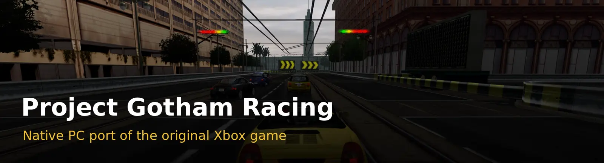
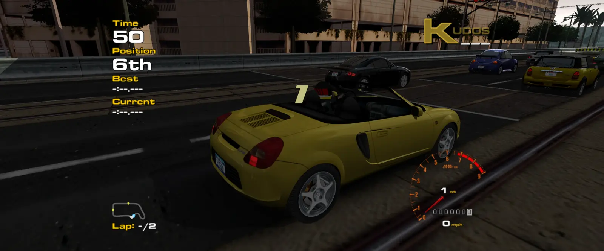
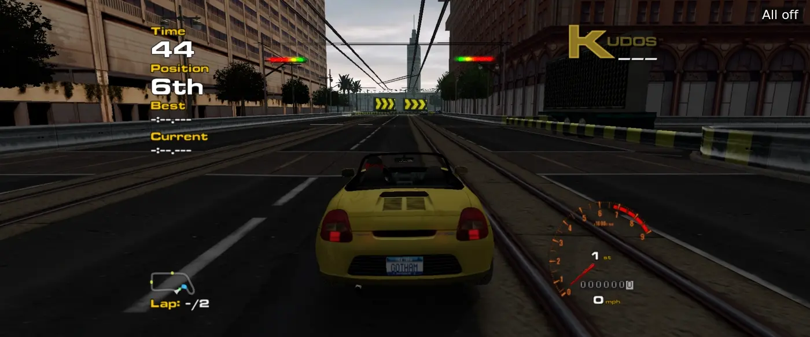
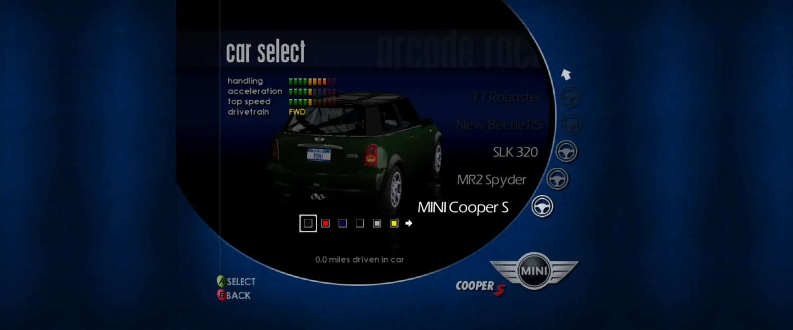
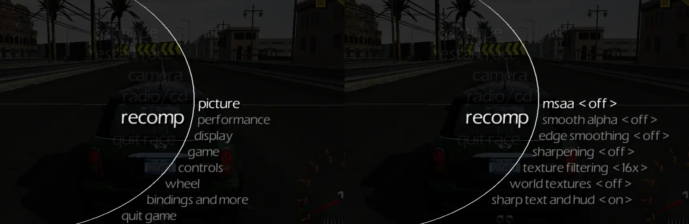
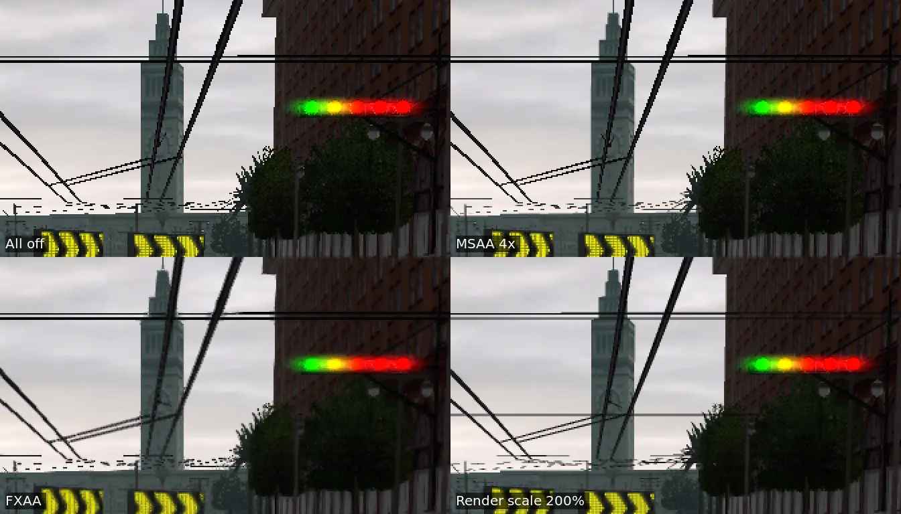
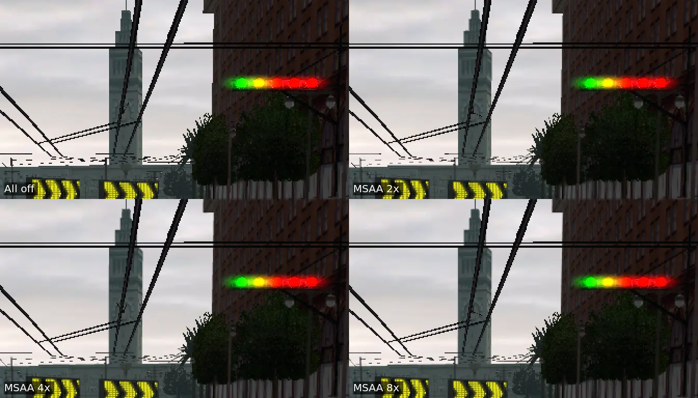
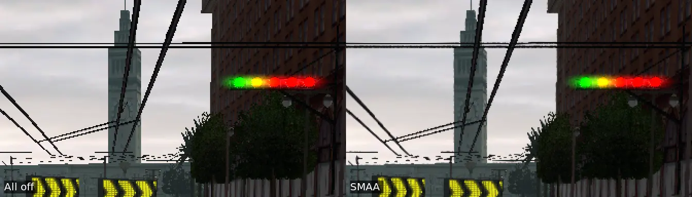
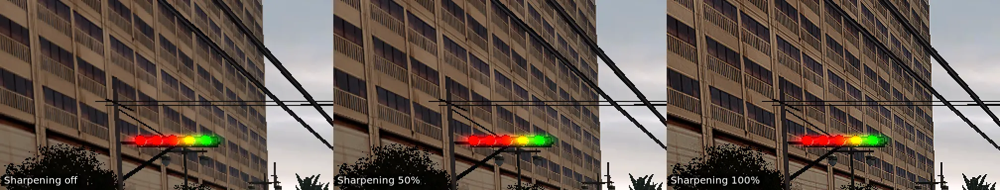

  

  
  
  

  <a href="#getting-started"><b>Getting started</b></a> &nbsp;·&nbsp;
  <a href="https://github.com/hk21x/pgr1-recomp/releases/latest"><b>Download</b></a> &nbsp;·&nbsp;
  <a href="#building"><b>Building</b></a> &nbsp;·&nbsp;
  <a href="https://discord.gg/PQjkKsdtc"><b>Discord</b></a>

  

**The 2001 Xbox launch racer, running natively on PC.** This is not an emulator. The game's own x86 code is
statically recompiled with the [Xbox XBE Recomp](https://github.com/TGP482/XboxXBE-Recomp) toolkit into a Windows
program, with a new renderer, sound and input underneath: true widescreen up to 21:9 and beyond, frame rates up to 144,
sharper graphics, keyboard, modern pads and wheels, and the PC settings inside the game's own menus.

> [!NOTE]
> This project does not include any game assets. You need your own copy of the Xbox game to play. The launcher builds
> the game's code on your PC from your disc.

## Table of contents

- [Xbox vs. PC](#xbox-vs-pc)
- [Features](#features)
- [Widescreen and the menus](#widescreen-and-the-menus)
- [The RECOMP menu](#the-recomp-menu)
- [Graphics settings](#graphics-settings)
- [Controls](#controls)
- [Achievements](#achievements)
- [Supported discs](#supported-discs)
- [Requirements](#requirements)
- [Getting started](#getting-started)
- [FAQ](#faq)
- [Known issues](#known-issues)
- [Roadmap](#roadmap)
- [Community and support](#community-and-support)
- [Building](#building)
- [Credits and legal](#credits-and-legal)

## Xbox vs. PC
[(Back to top)](#table-of-contents)

  
   
  <i>All extras off vs. render scale 200%, MSAA 4x and sharpening 50%, at 1920x800 (21:9).</i>

The Xbox drew Project Gotham Racing at 640x480, at 4:3 only, and at 60 frames a second, slowing the whole game down
when a frame came late. The port draws it at your screen's resolution and shape, keeps the game at the right speed
whatever the frame rate, can run it at up to 144 frames a second, and layers anti-aliasing and sharpening on top of
the game's own picture.

## Features
[(Back to top)](#table-of-contents)

| | |
|---|---|
| **Widescreen** | True proportions on any screen, 16:10, 16:9, 21:9 and wider. The 3D views widen to the screen at full sharpness; the race HUD is laid out at 4:3, 16:9 or out to the screen's sides, with the Kudos at the top right or top centre; the menus keep their 4:3 shape with the leather backdrop filling the sides. |
| **Game frame rate** | 60, 90, 120 or 144: the game runs and draws every frame at that rate, at the right speed. The renderer prepares each frame on two threads, so busy races hold 144 on a fast PC. |
| **Steady speed** | The game keeps real time when the frame rate dips; on the console a late frame put the whole game in slow motion. |
| **Sharper graphics** | Render scale from 25% to 200%, MSAA up to 8x, FXAA or SMAA, sharpening, anisotropic filtering up to 16x, enhanced world textures and sharp text and HUD. |
| **RECOMP in the game** | Options > RECOMP on the title menus and recomp in a race's pause menu, in the game's own style. Everything is also in the F1 window and `pgr1.toml`. |
| **Languages** | English, French, German, Spanish or Italian on the Europe and Japan discs. |
| **Controllers and wheels** | Xbox, PlayStation and Switch pads with hot plugging and rumble; any DirectInput wheel, pedals, H-pattern shifter or button box, with force feedback. |
| **3D sound** | The other cars' engines placed around you as the game intended, over XAudio2. |
| **Achievements** | 31, from every Kudos Challenge level to clean and night wins, with pop-ups and a list in the settings window. |
| **The launcher** | Choose your disc, Get the game ready, Play, Update: nothing installed in Windows, no admin rights, saves and settings kept. |
| **Quality of life** | Skip intro, a radio music level against the engines, field of view, hide the HUD, F12 screenshots at full resolution, pause in background, Alt+Enter for full screen. |

## Widescreen and the menus
[(Back to top)](#table-of-contents)

The console game is 4:3 only. In a race the 3D view widens to your screen's shape, and the HUD keeps each panel at its
true shape. **hud width** (recomp > game) lays it out at the console's **4:3**, at **16:9** (the default) or out to the
**screen**'s sides, and **kudos** puts the Kudos panel and its pop-ups at the **top right** or the **top centre**. The
race intro's black bars fit the screen, and on 16:10 screens (1920x1200, the Steam Deck) the game fills the screen too.
**race hud: hidden** clears the HUD for screenshots.

  
   
  <i>The menus keep their 4:3 shape, with the leather backdrop filling the sides. 1920x800 (21:9).</i>

## The RECOMP menu
[(Back to top)](#table-of-contents)

  
   
  <i>recomp in a race's pause menu, and its picture page.</i>

The port's settings live in the game's own menus: **Options > RECOMP** on the title menus, and **recomp** in a race's
pause menu. Most apply at once.

| Page | Settings |
|---|---|
| **picture** | MSAA, smooth alpha, edge smoothing (FXAA, SMAA), sharpening, texture filtering, world textures, sharp text and HUD |
| **performance** | Render scale, scaling filter, frame rate cap, low latency, frame counter, renderer (Direct3D 12 or 11) |
| **display** | Monitor, mode (full screen, borderless, window), resolution, vertical sync, aspect ratio |
| **game** | Game frame rate, field of view, race HUD, HUD width, Kudos position, radio music volume, language, skip intro, pause in background |
| **controls** | Keyboard, mouse look, default keys and controller |
| **wheel** | Invert steering, wheel rotation, steering lock, dead zone, force feedback, road and impacts |

**bindings and more** opens the **F1** window over the game, with the same settings and more: key and button bindings,
wheel setup and the achievements list. **quit game** leaves. Everything is saved in `pgr1.toml` beside the game. The
pause menu's recomp is not offered in multiplayer or a replay.

## Graphics settings
[(Back to top)](#table-of-contents)

Shots of the start line at 1920x800, taken one after another on an Intel Arc A750; the close-ups are enlarged twice.

  
   
  <i>Edges: all off, MSAA 4x, FXAA and render scale 200%.</i>

- **MSAA** smooths the edges of the 3D scene and keeps textures sharp. The more samples, the slower.

  
   
  <i>MSAA off, 2x, 4x and 8x.</i>

- **Edge smoothing** works on the finished frame, HUD included: FXAA softens it a little and can smudge thin lines,
  SMAA keeps it crisper.

  
   
  <i>Edge smoothing off vs. SMAA.</i>

- **Render scale** draws the picture larger than the screen: the smoothest fine detail, and the slowest.
- **Sharpening** makes the picture crisper. Around 50% is a good start; 100% turns brickwork and window frames gritty.

  
   
  <i>Sharpening off, 50% and 100%.</i>

- **Smooth alpha** softens fences, trees and other cut-out textures, with MSAA on.
- **Texture filtering** keeps roads and walls sharp into the distance.
- **Scaling filter** chooses how the frame reaches the screen when render scale is not 100%: bilinear, or sharp.
- **Renderer:** Direct3D 12 by default, or Direct3D 11 for graphics cards or drivers where 12 runs badly, at the next
  start. Without Direct3D 12 the game starts on 11 by itself.

## Controls
[(Back to top)](#table-of-contents)

The keyboard plays as controller 1 while the window has the focus. Keys stand for the Xbox pad's inputs, two keys each,
and any of them can be changed in the F1 window.

| Xbox input | Keyboard | Modern pad |
|---|---|---|
| Steer, menus (left stick) | arrow keys, or A / D | left stick |
| Accelerate / brake | W / S | RT / LT |
| A / B / X / Y | Enter or Space / Backspace / Q / E | A / B / X / Y |
| Black / White | R / F | RB / LB |
| Start / Back | Esc or P / Tab | Menu / View |
| D-pad | numpad 8 / 2 / 4 / 6 | d-pad |
| Right stick, stick clicks | I J K L, C and V | right stick, stick clicks |
| Screenshot | F12 | |
| Settings window | F1 | Back + Start |
| Full screen | Alt+Enter | |

**Steering wheels and rigs:** any DirectInput wheel, pedal box, button box or shifter, also spread over several USB
devices. Each control is bound in F1 > Wheel by moving or pressing it, and force feedback on the steering's device
follows the player's car. An **H-pattern shifter** works with the manual gearbox: bind its positions in F1 > Wheel, and
the car follows the gear you select (the port presses the game's own shift up and down, A and B, until they match).

## Achievements
[(Back to top)](#table-of-contents)

31 achievements: every Kudos Challenge level, golds, Quick and Arcade Race, Kudos totals, cars, combos, clean and night
wins, and split screen. They pop up as you earn them, are listed in the settings window and kept in
`achievements.toml` beside the game. They are written in RetroAchievements' condition format; the set is in
[ACHIEVEMENTS.md](ACHIEVEMENTS.md).

## Supported discs
[(Back to top)](#table-of-contents)

Five Xbox releases of Project Gotham Racing (title id 4D530003). Each disc is its own compile of the game, so the game's
code is built from the one you give it, and the launcher downloads the package for it.

| Release | Disc image SHA-1 | `default.xbe` SHA-1 |
| --- | --- | --- |
| Europe 1.1 | `4608350bc01c9544da8bd46860ecdfb16cc2d6eb` | `4878c3bdbd44663b64ce64986b313e8c6b7f8917` |
| Europe and Australia 1.0 | `28bbf6c115f096eeb5785752e1bee34dc2cd7764` | `ba7763e6e946ab40aed6706f2c9bc1df3a990fa0` |
| USA 1.0 | `c20a9d1d0ee04daf6e9723767b1b9d1a8007445d` | `0d55fff29ceb34ab4dfcfc4820e823d967ca1469` |
| Asia | `95b9788eca5390a6246280095fc7756658f137e4` | `c14b35767fddc5a7af4b3aa13b53e374be23fe57` |
| Japan (World Street Racer) | `fdca8086c5bcbf9542f218863d413b48ba77402a` | `4c38cf630f7dc92a845d2141020157e78e682e3d` |

The log (`logs\pgr1.log`) names the SHA-1 of the `default.xbe` it found. The Japan disc plays in English for now. To
change disc, choose the other one in the launcher and build again.

## Requirements
[(Back to top)](#table-of-contents)

- **Your own copy of the game:** one of the [supported discs](#supported-discs), as an `.iso` image of your disc or a
  folder with the disc's files.
- **Windows 10 or 11, 64 bit**, and a graphics card with Direct3D 12 or 11.
- **Room** for the game's package (about 64 MB) and its build, plus your copy of the game, and an internet connection
  for the package.
- **Performance:** at the game's own 60 frames a second the port asks little of a PC from the last ten years. Higher
  game frame rates need more: a Ryzen 7 5800X3D holds 144 in busy races.

## Getting started
[(Back to top)](#table-of-contents)

`PGR1Launcher.exe` does everything for you: no Visual Studio, no Git, no command line, nothing installed in Windows and
no admin rights needed. The game's code is never downloaded: your PC builds it from your disc.

1. Download `PGR1Launcher.exe` from the [latest release](https://github.com/hk21x/pgr1-recomp/releases/latest).
2. Put it in a folder of its own with a short path (for example `C:\Games\PGR1`) and run it. Everything it makes goes in
   a `PGR1` folder beside it. Windows may warn about an unrecognised app: choose **More info**, then **Run anyway**.
3. **Your game:** choose your disc image or the folder with the disc's files. The launcher checks that it is a
   supported disc.
4. **Get the game ready:** the launcher downloads your disc's package (the program and a compiler, no game code), then
   your PC builds the game's code from your disc (about 12 seconds on a fast 16 thread PC). You can stop at any time;
   it carries on where it left off.
5. **Play.** The first start formats the emulated hard disk and copies the game's cache (about 90 seconds of black
   screen and a short movie); later starts are quick.

When a new release is out, the launcher offers it at the top of its window: **Update the launcher** downloads it,
checks it and restarts, then **Update** puts the new version in place, keeping your saves and settings. The new version
is built beside the game and only replaces it once it is ready, so a failed or stopped update leaves the game as it was.

**Coming from 1.3 or earlier:** those versions built everything from source with about 1.4 GB of tools. Put the new
launcher in place of the old one; it shows **A faster way to play**: press **Update**. Afterwards, **Manage > Remove
the old build tools** frees the old tools and source.

Files, all under the `PGR1` folder beside the launcher:
- `play\` the game: `PGR1.exe`, `PGR1.dll` (the game's code, built on your PC), `pgr1.toml` (settings), `hdd\`
  (profiles, saves and caches), `logs\pgr1.log` (the game's log), `achievements.toml`, `screenshots\`, `compiler\`
  (what builds the code)
- `launcher.log` the launcher's log (send it with any problem)

To remove everything, delete the launcher and its `PGR1` folder (keep `play\hdd` if you want your saves).

## FAQ
[(Back to top)](#table-of-contents)

<b>Is this an emulator?</b>

 
No. The game's x86 code is translated ahead of time into C++ and built as a Windows program. The Xbox's graphics,
sound and input are rebuilt for the PC underneath it. That is what makes true widescreen, a game frame rate of 144 and
settings inside the game's menus possible.

<b>Why a recompilation?</b>

 
Project Gotham Racing never came out on PC, and an emulator runs the game as the console did: 4:3, 60 frames a second
at most, in slow motion when a frame is late. A recompilation makes the whole game ours to change:
<ul>
<li><b>Changes in source.</b> The widened race view with the HUD at 16:9, the game running at 144, saves made at
another rate still loading, and RECOMP in the game's own menus were built that way.</li>
<li><b>One runtime for several games.</b> Widescreen, anti-aliasing, controllers and wheels, achievements and the
settings window come from the toolkit this port shares with other Xbox ports, and a fix made for one reaches the
others.</li>
<li><b>A present-day program.</b> 64 bit and Direct3D 12, with no old graphics or input layers to keep working on new
versions of Windows.</li>
</ul>

<b>Why do I need my own copy of the game?</b>

 
The game belongs to its rights holders. This project shares only its own work: the game's code is built on your PC
from your disc, and its assets are read from your disc.

<b>How do I play at 144?</b>

 
recomp > game > <b>game frame rate</b> (or F1), at the next start. Set vertical sync off, or use a screen that
refreshes at least that fast. Saves made at any game frame rate load at any other.

<b>Something is wrong. What should I send?</b>

 
The first lines of <code>logs\pgr1.log</code> beside the game list your settings, your graphics card and any
<code>XBE_*</code> or <code>PGR1_*</code> environment variables; leftover ones from experiments change how the game
draws. If the launcher's build fails, send <code>PGR1\launcher.log</code> (its Details section shows the same), and
press Build again after a network problem: it carries on where it stopped. "Another release" in the log means the
<code>default.xbe</code> is not the release this build was made from. To see a first boot again (the cache, the intro
movie), delete the <code>hdd</code> folder beside <code>PGR1.exe</code>. Ask on the
<a href="https://discord.gg/PQjkKsdtc">Discord server</a>, with <code>logs\pgr1.log</code>.

## Known issues
[(Back to top)](#table-of-contents)

- **The Japan disc plays in English:** its Japanese menus draw only their text, so Japanese is not offered yet.
- **Sound effects** such as reverb and filters are not modelled.
- **Not yet covered by testing:** split screen, system link, and replays at game frame rates above 60.
- **Push buffers** the game records for some models are not replayed yet, and there is no draw distance setting.

## Roadmap
[(Back to top)](#table-of-contents)

- **Japanese on the Japan disc.**
- **Split screen and system link** tested and working.
- **The game's sound effects:** reverb and filters.

Progress is in [PROGRESS.md](PROGRESS.md), and technical findings in [FINDINGS.md](FINDINGS.md).

## Community and support
[(Back to top)](#table-of-contents)

Join the [Discord server](https://discord.gg/PQjkKsdtc) for help getting the game running, to report problems, and to
talk about the port with other players.

## Building
[(Back to top)](#table-of-contents)

For developers. You need Windows 10 or 11 (64 bit), [Git](https://git-scm.com/download/win), Visual Studio 2022
(Community is fine) with **Desktop development with C++** (`build.bat` offers to add **C++ Clang tools for Windows** and
**C++ CMake tools for Windows**), about 3 GB free plus room for your copy of the game, and your disc's files.

1. Clone with submodules: `git clone --recurse-submodules https://github.com/hk21x/pgr1-recomp.git`
   (cloned without them? run `git submodule update --init`).
2. Put `default.xbe` from your disc in `assets` (the build recompiles from that file). To play, `assets` holds the
   disc: `default.xbe` with the game's folders beside it (`Async`, `FMV`, `FrontEnd`, `Game`, ...), or the `.iso` alone.
3. Run `build.bat`. The first build takes 30 to 90 minutes; later builds are quicker. Do not run `xbe_symbols` or edit
   `config\game.toml`: the committed configurations are the ones for the supported discs, and the build picks yours by
   its SHA-1.
4. Answer Y to "Play now?", or run `out\build\release\PGR1.exe`. It finds the `assets` folder beside itself or in any
   folder above it.

`launcher.bat` builds `PGR1Launcher.exe`. Files the game writes beside the exe: `pgr1.toml`, `hdd\` (delete it to start
again from a first boot), `logs\pgr1.log`, `achievements.toml`, `screenshots\`, and `CrashDumps\` if it crashes.
[WINDOWS.md](WINDOWS.md) has the diagnostic switches (frame captures with F3, `XBE_DSOUND_LOG` for sound, `XBE_PERF`
timings) and more.

## Credits and legal
[(Back to top)](#table-of-contents)

- [Xbox XBE Recomp](https://github.com/TGP482/XboxXBE-Recomp), the recompiler and runtime this is built on.
- [XenonRecomp](https://github.com/hedge-dev/XenonRecomp) for the overridable function layout and instruction hooks.
- [Zydis](https://github.com/zyantific/zydis) for decoding x86 instructions, [toml++](https://github.com/marzer/tomlplusplus)
  for the configs, [Dear ImGui](https://github.com/ocornut/imgui) for the settings overlay and
  [SDL](https://github.com/libsdl-org/SDL) for the window, input and controllers.

This project's code is released under the [MIT License](LICENSE). The SDK in `sdk/` keeps its own MIT license
([sdk/LICENSE](sdk/LICENSE)). Neither covers the game itself.

*Project Gotham Racing* © its respective rights holders. Developed by Bizarre Creations and published by Microsoft
Game Studios. This is an unofficial fan project, not affiliated with or endorsed by them. No game code or assets are
distributed: they are made from your own copy of the game. Car makers' names and marks seen in the screenshots belong
to their owners.

**AI disclosure:** much of this project's code, tooling and documentation was written with AI assistance (Anthropic's
Claude), directed, reviewed and playtested by the author.
