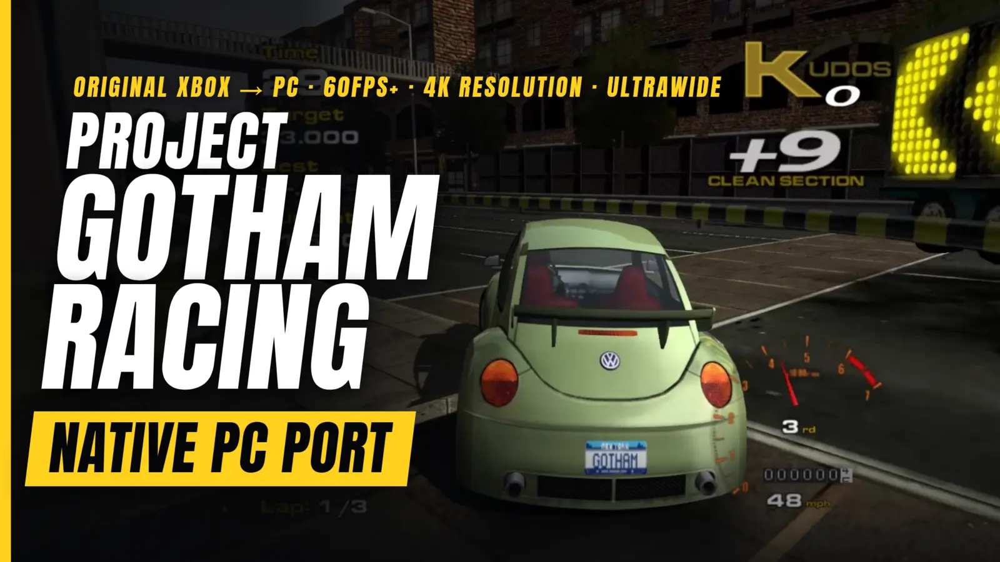

# Project Gotham Racing - XBE Recomp



An unofficial native PC port of the original Xbox version of Project Gotham Racing, with extended graphics options
and other enhancements. The game's own x86 code is statically recompiled into a Windows executable with the
[Xbox XBE Recomp](https://github.com/TGP482/XboxXBE-Recomp) tool; the Xbox's graphics, sound and system libraries are
reimplemented for Windows (Direct3D 12 or 11, XAudio2, SDL). It is not an emulator.

> [!NOTE]
> This project does not include any game assets. You must provide the files from your own legally acquired copy of
> the game to build and play.

## Supported Version

The European (PAL) Xbox release of Project Gotham Racing (title id 4D530003):

| Release | `default.xbe` SHA-1 |
| --- | --- |
| Europe (PAL), version 5 | `4878c3bdbd44663b64ce64986b313e8c6b7f8917` |

The log (`logs\pgr1.log`) names the SHA-1 of the `default.xbe` it found. Other releases (North American, Japanese,
Platinum Hits) have not been checked yet, and the game asks before starting one.

## Getting Started

There are two ways to get the game running. Both build it on your own PC from your own disc: the game's code is
never downloaded, only the tools and this project's source.

### The launcher (recommended)

`PGR1Launcher.exe` does everything for you: no Visual Studio, no Git, no command line, nothing installed in Windows
and no admin rights needed.

**You need:**
- Windows 10 or 11, 64 bit, and a GPU with Direct3D 12 or 11.
- Your own copy of the game (PAL): an `.iso` image of your disc, or a folder with the disc's files.
- About 15 GB free, and an internet connection for about 1.4 GB of build tools.

**Steps:**
1. Download `PGR1Launcher.exe` from the [latest release](https://github.com/hk21x/pgr1-recomp/releases/latest).
2. Put it in a folder of its own (for example `C:\Games\PGR1`) and run it. Everything it makes goes in a `PGR1`
   folder beside it. Windows may warn about an unrecognised app: choose **More info**, then **Run anyway**.
3. **Your game:** choose your disc image or the folder with the disc's files. The launcher checks that it is a
   supported release.
4. **Build:** accept the license terms for Microsoft's C++ libraries and Windows SDK (the build uses them), then press
   **Build**. It downloads portable build tools (Clang, CMake, Ninja, Git and Microsoft's libraries), this project's
   source, and builds the game. The first build takes 30 to 90 minutes. You can stop it at any time; it carries on
   where it left off.
5. **Play:** press **Play**. The first start formats the emulated hard disk and copies the game's cache (about 90
   seconds of black screen and a short movie); later starts are quick.

When a new release comes out the launcher offers it at start (**Update the launcher**, **What's new**, **Later**):
it downloads the new launcher, checks it and restarts, then offers to build the new version of the game (saves and
settings are kept). Launchers before 1.2 cannot do this: download 1.2's by hand once. **Remove the build files** frees
about 10 GB once the game is built (an update then builds everything again).

Files, all under the `PGR1` folder beside the launcher:
- `play\` the game: `PGR1.exe`, `pgr1.toml` (settings), `hdd\` (profiles, saves and caches), `logs\pgr1.log` (the game's
  log), `achievements.toml`
- `launcher.log` the launcher's log (send it with any problem building)
- `tools\` and `source\` the build tools and the source

To remove everything, delete the launcher and its `PGR1` folder (keep `play\hdd` if you want your saves).

### Building from source (developers)

**You need:** Windows 10 or 11 (64 bit), [Git](https://git-scm.com/download/win), Visual Studio 2022 (Community is
fine) with **Desktop development with C++** (`build.bat` offers to add **C++ Clang tools for Windows** and **C++ CMake
tools for Windows**), about 15 GB free, and your disc's files: `default.xbe` and its folders (`Async`, `FMV`,
`FrontEnd`, `Game`, `Images`, `media`, `Shaders`, ...), or an `.iso` image of the disc.

1. Clone the repository with its SDK:
   ```
   git clone --recurse-submodules https://github.com/hk21x/pgr1-recomp.git
   cd pgr1-recomp
   ```
   Cloned without `--recurse-submodules`? Run `git submodule update --init`.
2. Put your game files in the `assets` folder: `assets\default.xbe` with the game's folders beside it. With an `.iso`,
   put the `.iso` in `assets` and also copy `default.xbe` out of it into `assets` (the build recompiles from that file).
3. Run `build.bat` from Explorer or a command prompt. The first build takes 30 to 90 minutes; later builds are quicker.
   Do not run `xbe_symbols` or edit `config\game.toml`: the committed configuration is the one for the supported release.
4. Answer Y to "Play now?", or run `out\build\release\PGR1.exe`. It finds the `assets` folder beside itself or in any
   folder above it.

`launcher.bat` builds `PGR1Launcher.exe` itself. Files the game writes beside the exe: `pgr1.toml` (settings), `hdd\`
(saves and caches; delete it to start again from a first boot), `logs\pgr1.log`, `achievements.toml`, and
`CrashDumps\` if it crashes. [WINDOWS.md](WINDOWS.md) has more.

## Controls and Settings

**Settings window:** press **F1**, or **Back + Start** on a controller. Tabs: Display, Graphics, Game, Achievements,
General, Wheel and Controls. Changes are saved at once.

**Keyboard** (plays as controller 1 while the window has the focus; remap in Controls, two keys per input):

| Console input | Keys |
| --- | --- |
| Steer / menus (left stick) | Arrow keys, or A / D |
| Accelerate / brake | W / S |
| A / B / X / Y | Enter or Space / Backspace / Q / E |
| Black / White | R / F |
| Start / Back | Escape or P / Tab |
| D-pad | Numpad 8 / 2 / 4 / 6 |
| Right stick, stick clicks | I J K L, C and V |

**Controllers:** Xbox, PlayStation and Switch controllers, with hot plugging and rumble; any console input can be
mapped to any controller input in Controls.

## Features

### Display
- **Display Modes** - Fullscreen, borderless window or window, at any resolution the monitor offers, applied at once.
- **Widescreen and Ultrawide** - The console game is 4:3 only. Here the 3D views widen to the screen's shape, 21:9 and
  wider included, at full sharpness. The race HUD is laid out at 16:9 (its panels out towards the sides, each at its true
  shape), the race intro's black bars fit the screen, and the menus stay 4:3 in the centre with black at the sides.
- **Frame Pacing** - Runs at the game's own rate, 60 frames a second in menus and races as on the console, with vsync
  and a frame rate cap.
- **Monitor** - Chooses which display the game uses.
- **FPS Counter** - Shows the frame rate in a corner.

### Graphics
- **Render Scale** - Renders at a percentage of the screen, from 25% to 200%.
- **Renderer** - Direct3D 12 (default) or Direct3D 11, at the next start; 11 for GPUs or drivers where 12 runs badly.
  Without Direct3D 12 the game starts on 11 by itself.
- **Anisotropic Filtering** - Up to 16x.
- **Antialiasing** - MSAA 2x, 4x or 8x on the 3D scene and FXAA on the finished frame, separately or together; render scale above 100% supersamples.
- **Field of View** - Widens or narrows the race camera, 50% to 200% of the console's.
- **Sharp Text and HUD** - The menus', HUD's and text's textures are enlarged with sharp edges, so lettering and gauges stay crisp at high resolutions (on by default).

### Controller
Supports Xbox, PlayStation and Switch controllers, with hot plugging and rumble. Any console input can be mapped to any controller input.

**Steering wheels and rigs** - any DirectInput wheel, pedal box, button box or shifter, also spread over several USB
devices; each control bound in F1 > Wheel by moving or pressing it, and force feedback on the steering's device that
follows the player's car.

### Keyboard
Plays as controller 1, with two keys for each console input, remappable in the settings window.

### General
- **Launcher** - `PGR1Launcher.exe`: choose your disc, Build, Play, Update; portable build tools, nothing installed.
- **Settings Window** - Press F1, or Back + Start on a controller, for display, graphics, game options, the wheel and controls. Changes are saved to `pgr1.toml`.
- **Skip Intro** - Skips the intro movie, the logos and the warning, straight to the title screen.
- **Hide HUD** - Clears the race HUD for screenshots.
- **Radio Music Volume** - The radio's music against the engine and effects (150% by default; 100% is the game's own balance).
- **Pause On Focus Loss** - The game and its sound stop while another window is in front.
- **Saves** - Profiles, options and Kudos Challenge progress are kept on an emulated hard disk beside the exe.
- **Achievements** - 31 achievements (every Kudos Challenge level, golds, Quick and Arcade Race, Kudos totals, cars, combos, clean and night wins, split screen) with pop-ups and a list in the settings window, written in RetroAchievements' condition format; the set is in [ACHIEVEMENTS.md](ACHIEVEMENTS.md).

### Miscellaneous
- **Boot Splash** - Place a `splash.png` (or `.bmp`) beside the exe to display a splash screen at launch.
- **Diagnostics** - Logs to `logs\pgr1.log`, and offers frame captures (F3). See [WINDOWS.md](WINDOWS.md).

## Status

Boots, plays the movies and menus, saves, and races at 60 frames a second; widescreen and ultrawide, MSAA, wheels and
the settings window in. Open: system link and split screen have not been tried, the recorded push buffers the game
uses for some models are not replayed yet, and there is no draw distance setting. Progress is in
[PROGRESS.md](PROGRESS.md), and technical findings in [FINDINGS.md](FINDINGS.md).

## Community and Support

Join the [Discord server](https://discord.gg/PQjkKsdtc) for help getting the game running, to report problems,
and to talk about the port with other players.

## Troubleshooting

- Something wrong: the first lines of `logs\pgr1.log` list the settings, the GPU and any `XBE_*` or `PGR1_*`
  environment variables; leftover ones from experiments change how the game draws. [WINDOWS.md](WINDOWS.md) lists
  the diagnostic switches (frame captures with F3, `XBE_DSOUND_LOG` for sound, `XBE_PERF` timings).
- The launcher's build failing: send `PGR1\launcher.log` (its Details section shows the same). Press Build again
  after a network problem: it carries on where it stopped.
- "Another release" in the log, or the game not starting: the `default.xbe` is not the supported release.
- A first boot again (the cache, the intro movie): delete the `hdd` folder beside `PGR1.exe` (`PGR1\play\hdd` with
  the launcher, `out\build\release\hdd` when built from source).
- Still stuck: ask on the [Discord server](https://discord.gg/PQjkKsdtc), with `logs\pgr1.log`.

## Credits

- [Xbox XBE Recomp](https://github.com/TGP482/XboxXBE-Recomp), the recompiler and runtime this is built on.
- [XenonRecomp](https://github.com/hedge-dev/XenonRecomp) for the overridable function layout and instruction hooks.
- [Zydis](https://github.com/zyantific/zydis) for decoding x86 instructions, [toml++](https://github.com/marzer/tomlplusplus) for the configs, [Dear ImGui](https://github.com/ocornut/imgui) for the settings overlay and [SDL](https://github.com/libsdl-org/SDL) for the window, input and controllers.

## License

This project's code is released under the [MIT License](LICENSE). The SDK in `sdk/` keeps its own MIT license
([sdk/LICENSE](sdk/LICENSE)). Neither covers Project Gotham Racing itself: the game's code and assets belong to their
owners and are not part of this repository.
